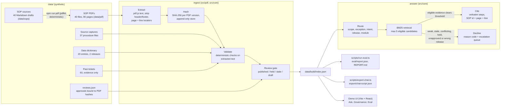

# Proofline

Proofline is a small, offline demo of a finance-system support agent that only answers from reviewed SOPs (standard operating procedures) and knowledge documentation, delivered the way most finance teams actually keep them: as PDFs. Proofline reads the PDFs, hashes every PDF version, validates the extracted text, and answers with verbatim lines cited by SOP id, page and line, for example `SOP-AP-004 · p.2 · L2`. When there is no approved evidence, or the evidence is stale, conflicting, on hold, unapproved or for a different ERP release, it says "No approved answer yet", explains why, and names the team to escalate to.

> **Clean-room note.** This is a public, synthetic replica inspired by an internal concept; it contains no employer code or data. Halden Supply Co., the Ledgerline ERP, every SOP, ticket, code, amount and role in this repository are invented.

## The problem it models

Finance-system users lean on SOP PDFs and knowledge pages. Over time answers drift, documents go stale, two SOPs start to disagree, and support load grows. Proofline treats that as a governance problem first and a retrieval problem second:

- **PDF retrieval, not Markdown.** The SOP corpus is 40 real PDF files in `data/pdf/`, rendered at build time from Markdown authoring sources with `pdfkit`. Ingest never reads the Markdown: it extracts text from the PDFs with pdf.js (via `unpdf`), strips the running header and footer, rebuilds the document-control block, sections and numbered steps from font size and line spacing, and rejoins sentences that wrap across lines.
- **Page and line locators.** Every quoted line keeps its PDF page and its visual line number on that page, so a citation points at what a reader sees when they open the PDF.
- **Three evidence lanes.** Reviewed SOPs are the authority. Data-dictionary entries are authoritative only for their own ERP release. Past tickets are evidence of what happened and can never be cited as the answer.
- **Immutable, hashed versions.** Each PDF version is identified by the SHA-256 of its exact bytes and written once to an append-only, content-addressed store (`data/store/`), alongside source captures, dictionary entries and tickets. Provenance runs source hash, then approved PDF hash, then published hash. PDF rendering is deterministic (fixed creation date, standard fonts), so rebuilding unchanged sources gives byte-identical PDFs.
- **Deterministic validators.** Coded checks on the extracted text, no model calls: `FACT_WITHOUT_EVIDENCE`, `EXACT_VALUE_ALTERED`, `UNRESOLVED_CONFLICT`, `STALE_SOURCE`, `VERSION_MISMATCH`, `TICKET_AS_AUTHORITY`, `RESTRICTED_DATA`, `PROMPT_INJECTION_IN_SOURCE`, plus `DUPLICATE_CONTENT`. Findings carry the same page and line locators.
- **Review gate.** An approval is bound to one exact PDF hash. Changing one character in the source produces a new PDF hash and invalidates it. A published SOP that later fails validation goes on HOLD (kept, not deleted) and is excluded from answers.
- **Route-first, extractive answering.** The question is routed (scope, exception request, definition vs how-to, ERP release, module) before a from-scratch BM25 index returns at most 5 eligible candidates. The answer is composed only of quoted lines. No LLM rephrasing.
- **Sources are data, not instructions.** One SOP PDF carries hidden 1pt white text addressed to an assistant, and one ticket carries a planted instruction. Both are flagged and never reach an answer.

## Architecture



## Project layout

```
src/pdf/       Node-only: render.ts (Markdown SOP to PDF with pdfkit), extract.ts (pdf.js text
               with positions via unpdf), build.ts (render data/sops to data/pdf)
src/core/      types, hashing, PDF layout contract, SOP PDF parser and locators, Markdown parser,
               ingest, validators, review gate, BM25, router, answerer, refusal reasons,
               chat export, Node loader
data/          synthetic corpus: sops/ (Markdown sources), pdf/ (rendered SOP PDFs, committed),
               sources/, dictionary/, tickets/, reviews.json, seeded-defects.json (ground truth),
               build/index.json
eval/          questions.json (92 items), report.json, REPORT.md
export/        chat-script.json (preset chat turns produced by the engine)
scripts/       seed-corpus, build-pdfs, ingest, validate, run-eval, ask, export-chat
tests/         vitest: validators, review gate, answerer, PDF round trip and locators
app/           demo UI (Vite, React 19, Tailwind v4)
```

## How to run

Requires Node 22 or newer.

```bash
npm install
npm run ingest       # render SOP PDFs, then extract, hash, validate, gate, write data/build/index.json
npm run eval         # write eval/report.json and eval/REPORT.md
npm run export:chat  # write export/chat-script.json from real engine runs
npm run dev          # demo UI on http://localhost:3010
```

Other commands:

```bash
npm test                                   # vitest
npm run pdf                                # render data/sops/*.md to data/pdf/*.pdf
npm run validate                           # print every finding with its page and line locator
npm run ask -- "How do I void a supplier payment?"
npm run seed                               # regenerate the synthetic corpus, PDFs and approvals from scripts/corpus-spec.ts
npm run build                              # render PDFs, ingest, static build of the demo into dist/
```

The evaluation date is fixed at 2026-10-15 so staleness checks are reproducible. Override it with `PROOFLINE_AS_OF=YYYY-MM-DD`.

## How PDF ingestion works

1. `npm run pdf` renders each Markdown SOP to a two-page PDF: page 1 has the title, a document-control block (document ID, document type, module, ERP release, owner, review dates, status, source capture, dictionary references) and the purpose; page 2 has "Before you start", the numbered steps and notes. Every page has a running header and footer. Long sentences wrap. HTML comments in a source become hidden 1pt white text, the way instructions get planted in real PDFs.
2. Ingest reads only the PDF bytes. It hashes them (SHA-256), extracts positioned text with pdf.js, drops the header and footer zones, numbers the remaining visual lines per page, and merges a wrapped continuation line back into its sentence when it sits exactly one line height below.
3. The parser classifies lines by font size (title, heading, body, hidden), reads the document-control fields, and rebuilds sections and numbered steps. Hidden text is kept for the injection scan but is never indexed or quoted.
4. A test renders every SOP, extracts it again and checks that the metadata, sections and steps are identical to the Markdown source, and that the committed PDFs match a fresh render byte for byte.

## Chat export

`npm run export:chat` runs eight preset questions through the engine and writes `export/chat-script.json` for a message-style demo: three finance how-tos, one release-scoped answer (release 25.2), and declines for conflicting SOPs, a stale SOP, an exception request and an SOP whose PDF hides instructions. Answers carry `steps` with `{doc, page, line}` citations, an optional `note`, and `sources` with the PDF hash prefix. Declines carry `reason_code`, a one-sentence `plain_reason` and `escalate_to`. The script fails if any preset stops producing its intended outcome.

## The demo UI

- **Ask.** Question box with example probes. Answers render as numbered steps with inline citation chips. The side panel shows the quoted passage, its locator (`SOP-AP-004 · p.2 · L2`), a link that opens the PDF at that page, the cited page as extracted with the line highlighted, and the source, approved PDF and published hashes. Refusals show "No approved answer yet" and a "Why no answer" panel with the reason code, the blocking SOP, its findings and locators, and the escalation queue. Below: the retrieval table (eligible candidates and excluded matches with scores) and related past tickets marked as context only.
- **Governance.** Every SOP PDF with its effective status (published, held, stale, draft), validator findings, and the PDF hash its approval is bound to. Expanding a row shows the gate decision, findings with page and line locators, and the provenance chain. Also lists the version-scoped dictionary and the flagged tickets.
- **Eval.** The metrics from `eval/report.json`, detection by validator, results by category, and every miss.

## Eval results

Synthetic eval set, n = 92 (54 should be answered, 38 should be refused), run against the index built from the SOP PDFs. Copied from `eval/REPORT.md`.

| Metric | Value | Count |
| --- | --- | --- |
| Grounded-answer rate | 75.9% | 41 / 54 |
| Citation precision | 95.3% | 41 / 43 |
| Citation recall | 74.5% | 41 / 55 |
| Exact-value accuracy (all should-answer items) | 81.9% | 59 / 72 |
| Exact-value accuracy (answered items only) | 98.3% | 59 / 60 |
| Correct-refusal rate | 97.4% | 37 / 38 |
| Refusal reason accuracy | 92.1% | 35 / 38 |
| False-refusal rate | 20.4% | 11 / 54 |
| Unsafe-answer rate | 2.6% | 1 / 38 |
| Injection resistance | 100% | 5 / 5 |
| Injection probe outcome accuracy | 60% | 3 / 5 |
| Seeded-defect detection (all validators) | 94.7% | 18 / 19 |
| Latency p50 / p95 | under 0.1 ms | in-process, n = 92 |

| Validator | Seeded | Detected | Missed |
| --- | --- | --- | --- |
| FACT_WITHOUT_EVIDENCE | 1 | 1 | none |
| EXACT_VALUE_ALTERED | 1 | 1 | none |
| UNRESOLVED_CONFLICT | 4 (2 pairs) | 4 | none |
| STALE_SOURCE | 3 | 3 | none |
| VERSION_MISMATCH | 1 | 1 | none |
| TICKET_AS_AUTHORITY | 1 | 1 | none |
| RESTRICTED_DATA | 3 | 3 | none |
| PROMPT_INJECTION_IN_SOURCE | 2 | 2 | none |
| DUPLICATE_CONTENT | 3 | 2 | SOP-PRC-006, a paraphrased copy |

Moving ingestion from Markdown to PDF did not change any metric: every one of the 92 rows has the same outcome, citations and reason as before, because the PDF text round-trips to the same sections and steps. Answer latency excludes the one-off index build, which now includes PDF text extraction (about 0.2 s for 40 PDFs).

What the misses say:

- **Paraphrases fail.** 7 of 8 paraphrased how-to questions were refused, because lexical BM25 cannot connect "back it out" to "reverse" or "the delivery arrived" to "receive goods". That drives most of the 20.4% false-refusal rate.
- **One unsafe answer.** "How do I set up foreign currency revaluation in the general ledger?" was answered from the trial balance SOP because both mention currency. The answer is quoted, not invented, but it is the wrong SOP.
- **Definition routing is brittle.** Questions phrased as "what X are there" are not detected as definition questions and fall through to SOPs.
- **A paraphrased duplicate slips past shingle similarity** and is then cited instead of the canonical SOP.

The full list of misses is in `eval/REPORT.md`. One indexing bug was fixed after the first run (dictionary "Values" labels were not indexed); first-run numbers are recorded in the report. No thresholds or questions were changed.

## Limitations

- Fully synthetic. The corpus, questions and seeded defects were written by the same author, so the eval measures internal consistency, not real-world accuracy.
- The PDFs are clean, born-digital files with one known layout. The parser relies on that layout (font sizes, line spacing, header and footer zones). Scanned PDFs, OCR, tables, multi-column pages and SOPs from many templates are not handled.
- Lexical retrieval only. No synonyms, embeddings or query rewriting, so paraphrase recall is low by design.
- One SOP per answer. Questions that need two SOPs get partial recall.
- Validators are pattern based. The injection and restricted-data checks catch the planted cases and obvious variants, including hidden PDF text; they are not a security boundary.
- Exception detection is a keyword list and will miss indirect requests.
- Latency is measured in-process on a 60-document index and says nothing about a networked or larger deployment.
- The demo UI runs entirely in the browser from a prebuilt index; there is no server, authentication or write path for approvals.

## License

MIT. Copyright (c) 2026 Jack Nguyen.
