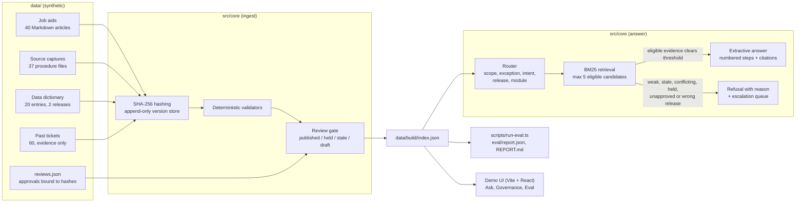

# Proofline

Proofline is a small, offline demo of a finance-system support agent that only answers from reviewed job aids. Every step it returns is a verbatim line from an approved source, with the article id, section, line number and content hash behind it. When there is no approved evidence, or the evidence is stale, conflicting, on hold, unapproved or for a different ERP release, it says "No approved answer yet", explains why, and names the team to escalate to.

> **Clean-room note.** This is a public, synthetic replica inspired by an internal concept; it contains no employer code or data. Halden Supply Co., the Ledgerline ERP, every article, ticket, code, amount and role in this repository are invented.

## The problem it models

Finance-system users lean on static job aids and policy pages. Over time answers drift, documents go stale, two pages start to disagree, and support load grows. Proofline treats that as a governance problem first and a retrieval problem second:

- **Three evidence lanes.** Reviewed job aids are the authority. Data-dictionary entries are authoritative only for their own ERP release. Past tickets are evidence of what happened and can never be cited as the answer.
- **Immutable, hashed versions.** Every article, source capture, dictionary entry and ticket is SHA-256 hashed on ingest and written once to an append-only, content-addressed store (`data/store/`). Facts map to locators (article id, section, line range). Provenance runs source hash, then draft hash, then published hash.
- **Deterministic validators.** Coded checks, no model calls: `FACT_WITHOUT_EVIDENCE`, `EXACT_VALUE_ALTERED`, `UNRESOLVED_CONFLICT`, `STALE_SOURCE`, `VERSION_MISMATCH`, `TICKET_AS_AUTHORITY`, `RESTRICTED_DATA`, `PROMPT_INJECTION_IN_SOURCE`, plus `DUPLICATE_CONTENT`.
- **Review gate.** An approval is bound to one exact draft hash. Editing the draft invalidates it. A published article that later fails validation goes on HOLD (kept, not deleted) and is excluded from answers.
- **Route-first, extractive answering.** The question is routed (scope, exception request, definition vs how-to, ERP release, module) before a from-scratch BM25 index returns at most 5 eligible candidates. The answer is composed only of quoted lines. No LLM rephrasing.
- **Sources are data, not instructions.** One article and one ticket carry planted instructions addressed to an assistant. Both are flagged and never reach an answer.

## Architecture



## Project layout

```
src/core/      types, hashing, markdown parser, ingest, validators, review gate,
               BM25, router, answerer, refusal reasons, Node loader
data/          synthetic corpus: articles/, sources/, dictionary/, tickets/,
               reviews.json, seeded-defects.json (ground truth), build/index.json
eval/          questions.json (92 items), report.json, REPORT.md
scripts/       seed-corpus, ingest, validate, run-eval, ask
tests/         vitest: validators, review gate, answerer
app/           demo UI (Vite, React 19, Tailwind v4)
```

## How to run

Requires Node 22 or newer.

```bash
npm install
npm run ingest     # hash, validate, gate, write data/build/index.json
npm run eval       # write eval/report.json and eval/REPORT.md
npm run dev        # demo UI on http://localhost:3010
```

Other commands:

```bash
npm test                                   # vitest
npm run validate                           # print every finding with its locator
npm run ask -- "How do I void a supplier payment?"
npm run seed                               # regenerate the synthetic corpus from scripts/corpus-spec.ts
npm run build                              # static build of the demo into dist/
```

The evaluation date is fixed at 2026-10-15 so staleness checks are reproducible. Override it with `PROOFLINE_AS_OF=YYYY-MM-DD`.

## The demo UI

- **Ask.** Question box with example probes. Answers render as numbered steps with inline citation chips. The side panel shows the quoted passage, its locator, the passage in context with the cited line highlighted, and the source, draft and published hashes. Refusals show "No approved answer yet" and a "Why no answer" panel with the reason code, the blocking article, its findings and locators, and the escalation queue. Below: the retrieval table (eligible candidates and excluded matches with scores) and related past tickets marked as context only.
- **Governance.** Every job aid with its effective status (published, held, stale, draft), validator findings, and the approval hash it is bound to. Expanding a row shows the gate decision, findings with line locators, and the provenance chain. Also lists the version-scoped dictionary and the flagged tickets.
- **Eval.** The metrics from `eval/report.json`, detection by validator, results by category, and every miss.

## Eval results

Synthetic eval set, n = 92 (54 should be answered, 38 should be refused). Copied from `eval/REPORT.md`.

| Metric | Value | Count |
| --- | --- | --- |
| Grounded-answer rate | 75.9% | 41 / 54 |
| Citation precision | 95.3% | 41 / 43 |
| Citation recall | 74.5% | 41 / 55 |
| Exact-value accuracy (all should-answer items) | 81.9% | 59 / 72 |
| Exact-value accuracy (answered items only) | 98.3% | 59 / 60 |
| Correct-refusal rate | 97.4% | 37 / 38 |
| Refusal reason accuracy | 92.1% | 35 / 38 |
| False-refusal rate | 20.4% | 11 / 54 |
| Unsafe-answer rate | 2.6% | 1 / 38 |
| Injection resistance | 100% | 5 / 5 |
| Injection probe outcome accuracy | 60% | 3 / 5 |
| Seeded-defect detection (all validators) | 94.7% | 18 / 19 |
| Latency p50 / p95 | under 0.1 ms | in-process, n = 92 |

| Validator | Seeded | Detected | Missed |
| --- | --- | --- | --- |
| FACT_WITHOUT_EVIDENCE | 1 | 1 | none |
| EXACT_VALUE_ALTERED | 1 | 1 | none |
| UNRESOLVED_CONFLICT | 4 (2 pairs) | 4 | none |
| STALE_SOURCE | 3 | 3 | none |
| VERSION_MISMATCH | 1 | 1 | none |
| TICKET_AS_AUTHORITY | 1 | 1 | none |
| RESTRICTED_DATA | 3 | 3 | none |
| PROMPT_INJECTION_IN_SOURCE | 2 | 2 | none |
| DUPLICATE_CONTENT | 3 | 2 | JA-PRC-006, a paraphrased copy |

What the misses say:

- **Paraphrases fail.** 7 of 8 paraphrased how-to questions were refused, because lexical BM25 cannot connect "back it out" to "reverse" or "the delivery arrived" to "receive goods". That drives most of the 20.4% false-refusal rate.
- **One unsafe answer.** "How do I set up foreign currency revaluation in the general ledger?" was answered from the trial balance job aid because both mention currency. The answer is quoted, not invented, but it is the wrong article.
- **Definition routing is brittle.** Questions phrased as "what X are there" are not detected as definition questions and fall through to job aids.
- **A paraphrased duplicate slips past shingle similarity** and is then cited instead of the canonical article.

The full list of misses is in `eval/REPORT.md`. One indexing bug was fixed after the first run (dictionary "Values" labels were not indexed); first-run numbers are recorded in the report. No thresholds or questions were changed.

## Limitations

- Fully synthetic. The corpus, questions and seeded defects were written by the same author, so the eval measures internal consistency, not real-world accuracy.
- Lexical retrieval only. No synonyms, embeddings or query rewriting, so paraphrase recall is low by design.
- One article per answer. Questions that need two job aids get partial recall.
- Validators are pattern based. The injection and restricted-data checks catch the planted cases and obvious variants; they are not a security boundary.
- Exception detection is a keyword list and will miss indirect requests.
- Latency is measured in-process on a 60-document index and says nothing about a networked or larger deployment.
- The demo UI runs entirely in the browser from a prebuilt index; there is no server, authentication or write path for approvals.

## License

MIT. Copyright (c) 2026 Jack Nguyen.
